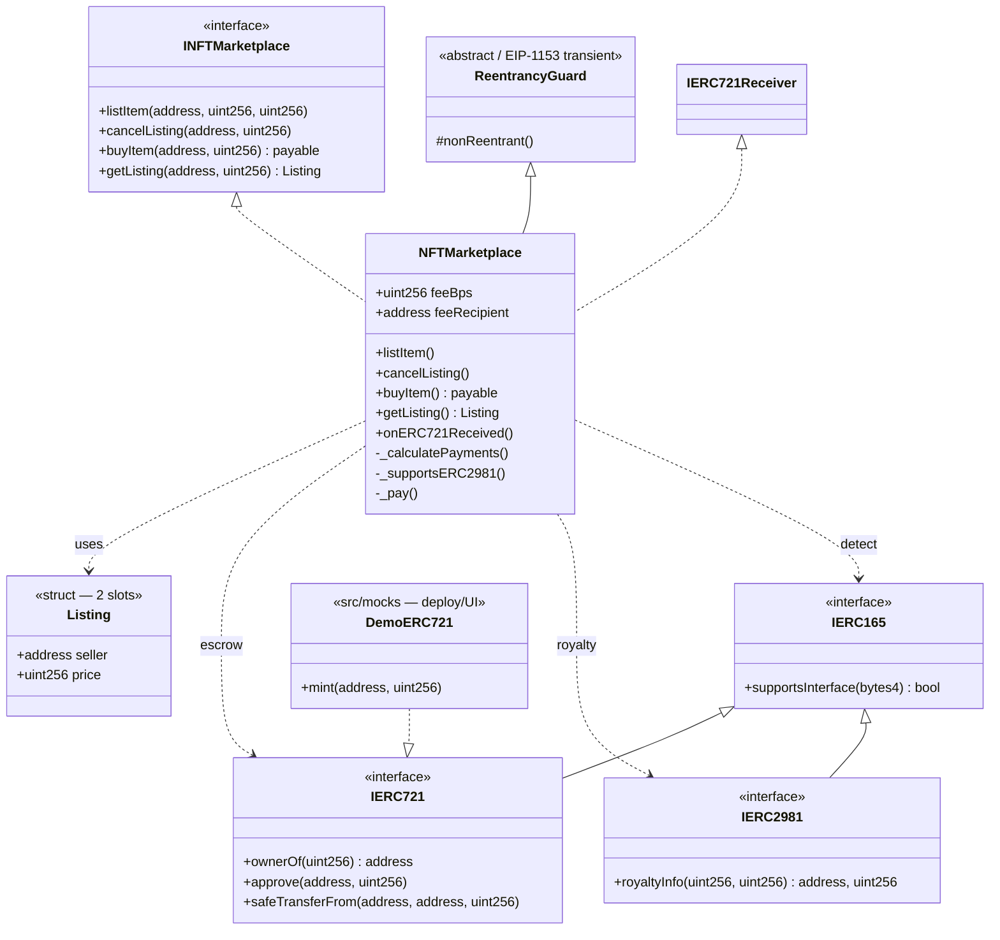
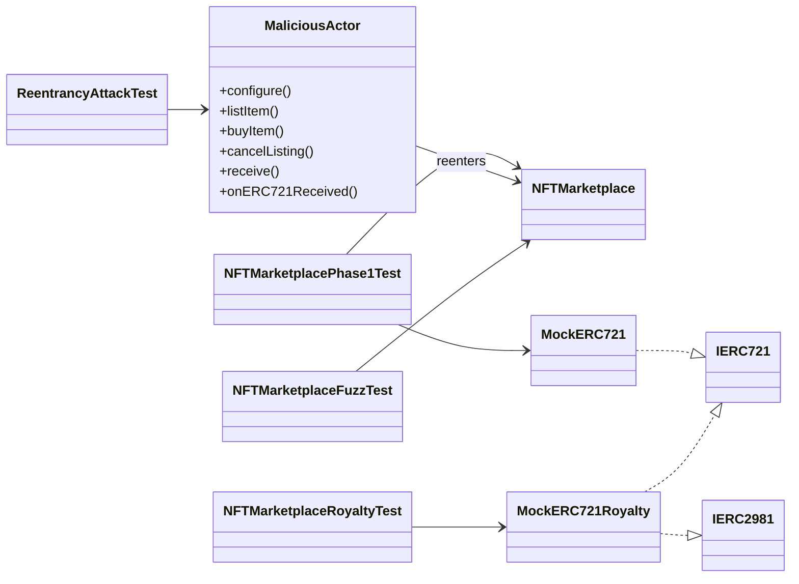
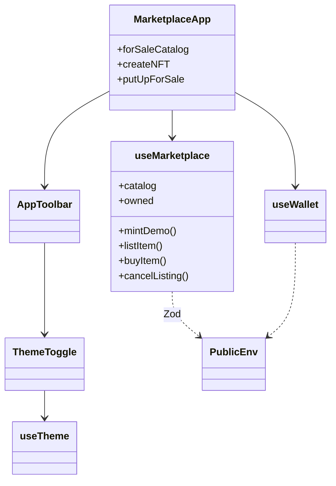

# Class diagram — NFT Marketplace

**As-built** structural model (closed module): contracts, mocks, tests and demo.

## 1. Main diagram (UML / Mermaid)



## 2. Tests and malicious actors



## 3. Frontend (demo)



The UI exposes three zones: **For sale** (catalog), **Create NFT** (mint), **Put up for sale** (approve + list).

## 4. Responsibilities

| Artifact | Role |
|----------|------|
| `NFTMarketplace` | Escrow, list/cancel/buy, fee/royalty/seller split |
| `Listing` | `{seller, price}` — 2 slots; keys = nft + tokenId |
| `ReentrancyGuard` | Transient lock on buy/cancel |
| `DemoERC721` | Demo NFT for Anvil / UI |
| `MockERC721` / `MockERC721Royalty` | Foundry tests |
| `MaliciousActor` | SWC-107 vectors |
| `MarketplaceApp` | 3-zone UI: catalog / mint / put up for sale |
| `useMarketplace` | On-chain catalog, owned tokens, mint/list/buy/cancel |
| `ThemeToggle` / `useTheme` | Light / dark (`market-theme`) |

## 5. Dependencies (summary)

```
NFTMarketplace
  ├── inherits   → ReentrancyGuard (transient)
  ├── implements → INFTMarketplace, IERC721Receiver
  ├── stores     → Listing (2 slots)
  ├── integrates → IERC721
  ├── queries    → IERC165 + IERC2981
  ├── emits      → ItemListed / ItemCanceled / ItemBought
  └── reverts    → custom errors (INFTMarketplace)
```

## 6. Solidity layout

1. Imports / interfaces  
2. Contract `NFTMarketplace`  
3. State (`feeBps`, `feeRecipient`, `_listings`) — `Listing` lives in the interface  
4. Constructor → external (`listItem`, `cancelListing`, `buyItem`, `getListing`)  
5. `onERC721Received`  
6. Private: `_calculatePayments`, `_supportsERC2981`, `_pay`
