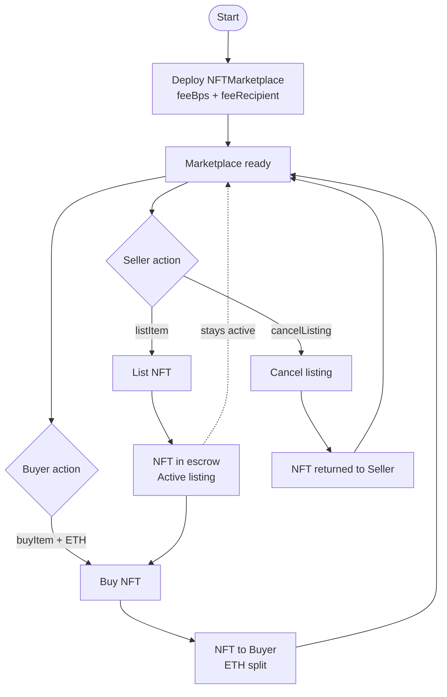
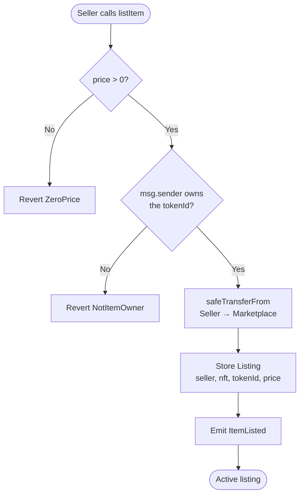
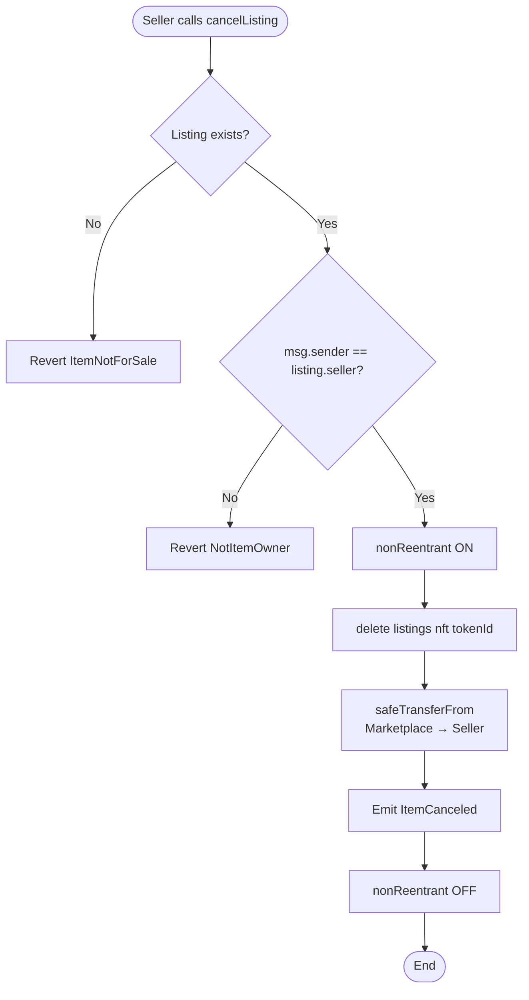
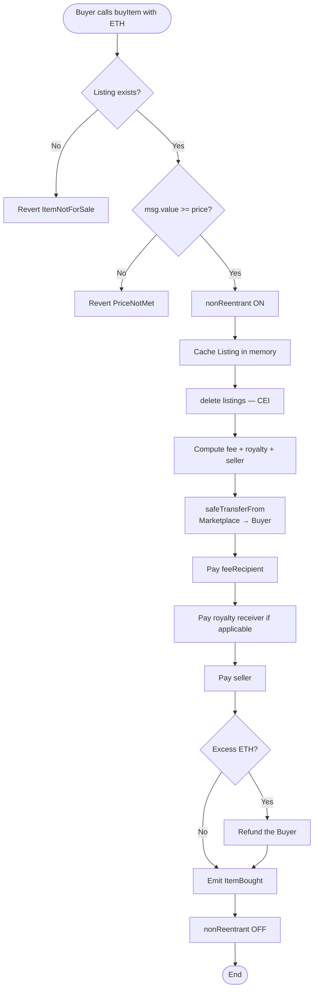
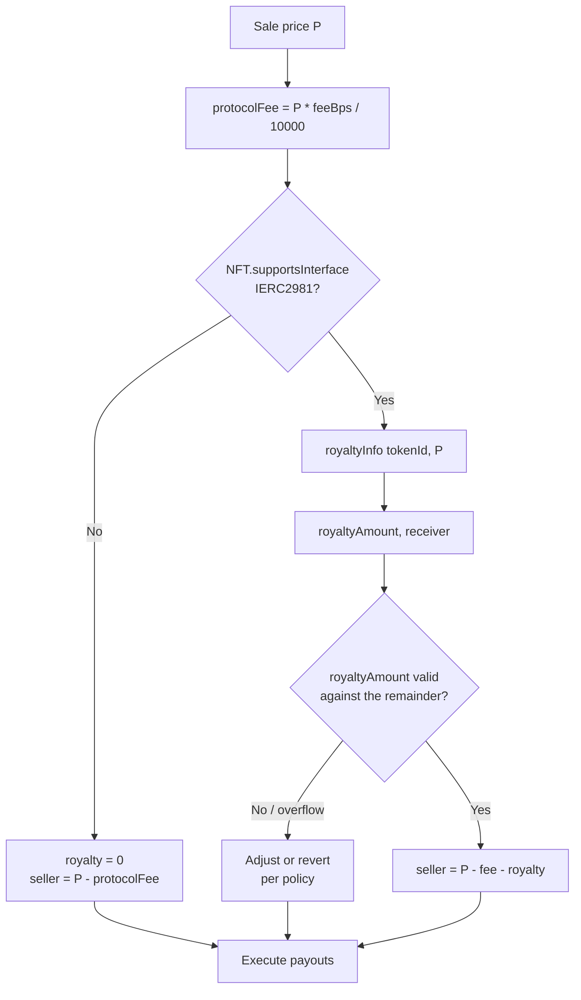

# Flow diagram — NFT Marketplace

**As-built** business flows (v1, no `updateListing`). See also [flujograma-EN.md](./flujograma-EN.md) and [DEPLOY-EN.md](./DEPLOY-EN.md) (UI).

## 1. Full listing lifecycle

## 2. Listing flow (`listItem`)

## 3. Cancellation flow (`cancelListing`)

## 4. Purchase flow (`buyItem`)

## 5. Royalty decision (ERC-2981)

## Legend

| Symbol | Meaning |
|--------|---------|
| Rectangle | Process / action |
| Diamond | Decision / validation |
| Oval | Start / end |
| Dashed arrow | Persistent state |
