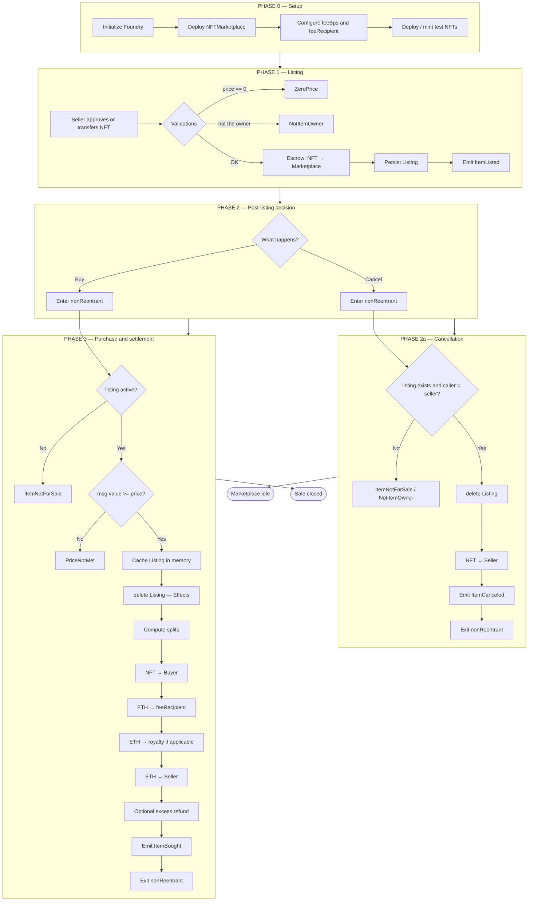
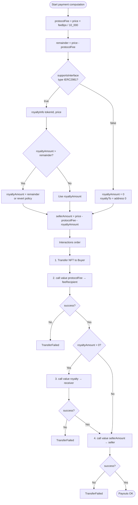
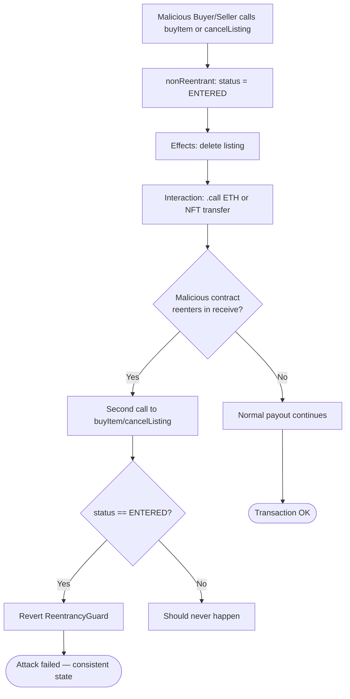
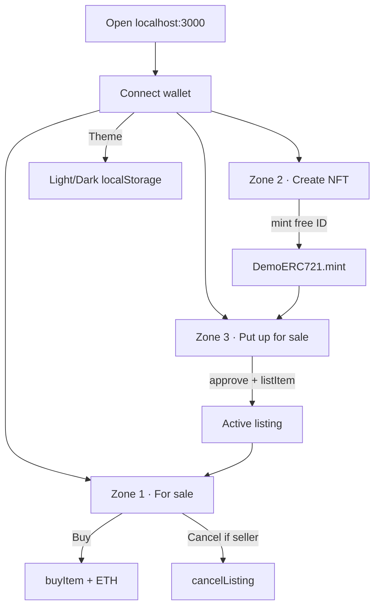

# Project flowchart — NFT Marketplace

**As-built** operational flowchart (v1): setup → list → cancel/buy → payouts → security → UI.

## 1. Master system flowchart

## 2. Detailed settlement flowchart (payouts)

## 3. Security flowchart (reentrancy)

## 4. Development pipeline flowchart (TDD) — completed

```mermaid
flowchart LR
    A[.cursorrules] --> B[Red .t.sol tests]
    B --> C[listItem]
    C --> D[cancelListing + guard]
    D --> E[buyItem + fee]
    E --> F[ERC-2981]
    F --> G[Attack SWC-107]
    G --> H[Fuzz 1000]
    H --> I[Gas + NatSpec]
    I --> J[Next.js demo + theme]
    J --> K([Module closed])
```

## 5. Flow ↔ function ↔ invariant matrix

| Flowchart step | Function | Invariant |
|----------------|----------|-----------|
| Escrow on listing | `listItem` | `ownerOf(tokenId) == marketplace` |
| Active listing | storage | `listings[nft][id].seller != 0` |
| Cancellation | `cancelListing` | NFT goes back to the seller; listing deleted |
| Pre-purchase | `buyItem` | `msg.value >= price` |
| Post-effects | `buyItem` | listing deleted **before** calls |
| Post-purchase | `buyItem` | `ownerOf == buyer`; sum of payouts = price |
| Reentry | transient guard | second call reverts |
| Without ERC-2981 | payout | seller receives `price - fee` |
| With ERC-2981 | payout | fee + royalty + seller = price |

## 6. UI flow (demo)

The UI separates **catalog**, **minting** and **publishing** (avoids mixing buttons).

Catalog: `ItemListed` events + `getListing` verification.  
Owned NFTs: `ownerOf` scan (demo, IDs 1…64).

Manual: `/ayuda` · setup: [`DEPLOY-EN.md`](./DEPLOY-EN.md).

## 7. How to read these diagrams

1. **Setup → Listing**: on-chain state.  
2. **Branch**: cancel or buy (no `updateListing` in v1).  
3. **Purchase**: CEI + splits + events.  
4. **Security / fuzz / UI**: module closure (phases 0–8 + demo).
